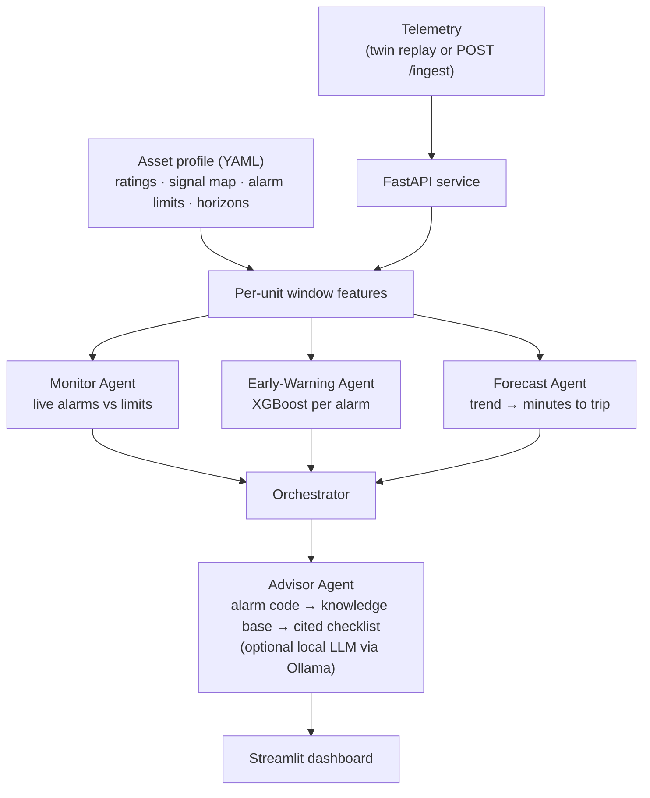

# Agentic Multi-Agent Decision Support for Industrial IoT Predictive Maintenance


M.Tech (Data Science & AI, PES University) Phase II project. A multi-agent platform that **predicts the alarms that
trip hybrid solar inverters and solar pump drives before they happen**, transfers across **power ratings by swapping
one profile file**, and returns a **cited maintenance checklist** for each alarm.

> **Read this first — data provenance.** Every number in this README comes from a **simulated telemetry twin**
> (healthy telemetry generated from weather, with injected, gradually growing faults). No real field data is
> bundled. Real datasets for validation are listed in [`data/real/README.md`](data/real/README.md); field
> performance has not yet been demonstrated.

## Problem and motivation

Hybrid inverters and pump drives trip on alarms (over-temperature, DC-link over-voltage, isolation faults, dry-run…).
Each trip means lost generation or pumping, a site visit, and a technician working from a long manual. Two gaps in the
baseline approach motivated this work:

1. **One model per device rating.** Data-driven models are usually trained per rating; fleets mix 3 kW, 5 kW and 10 kW
   units (or 3–10 HP drives).
2. **Prediction without action.** Knowing an alarm is coming is only useful if the technician knows what to check.

**Baseline:** ASPIRE (Datta & Guha, *IEEE Access*, 2026), reproduced in Phase I on MetroPT-3. This project
re-implements ASPIRE's **Prediction-Agent Transformer only** (not the full ASPIRE system) as a comparison model.

| Item | ASPIRE (as reproduced in Phase I) | This framework |
| --- | --- | --- |
| Assets | Metro air compressor (MetroPT-3) | Hybrid inverter, solar pump drive |
| Alarm types predicted | 1 failure category | 19 (11 inverter + 8 drive) |
| Power ratings | 1 | 3 per asset type, one model, profile swap |
| Fix guidance | None | Cited checklist per alarm code |

## Architecture



Key idea: every signal is converted to **per-unit** values using the profile's ratings (e.g. power / rated power,
temperature / trip temperature), so one model sees the same feature scale on a 3 kW and a 10 kW unit.

## Key features

- **Multi-fault early warning** — one XGBoost classifier per alarm code; decision thresholds tuned per alarm on a
  time-ordered validation split (last 20% of training).
- **Rating-agnostic by design** — train on 5 kW / 5 HP, test on 3 kW, 10 kW, 3 HP, 10 HP with no retraining.
- **Time-to-trip forecasting** for thermal alarms.
- **Alarm-to-action advisor** backed by `knowledge/fault_kb.yaml`, with an optional LLM write-up.
- **Serving stack** — FastAPI (`/ingest`, `/status`, `/forecast`, `/advice`, live feed) and a Streamlit dashboard.

## Tech stack

Python · NumPy · pandas · scikit-learn · XGBoost · PyTorch (baseline only) · FastAPI · Streamlit · Plotly · PyYAML ·
pytest · Ruff · GitHub Actions

## Results (full run — simulated twin)

Setup: 40 test days per unit, 3 seeds (11, 12, 13) per rating; training on one 60-day unit per asset type (seed 1).
Full tables: [`results/report.md`](results/report.md). Configuration: [`results/run_meta.json`](results/run_meta.json).

**E1 / E2 — early-warning macro-F1** (higher is better):

| Asset | Method | 5 kW / 5 HP (trained) | 3 kW / 3 HP | 10 kW / 10 HP | False alerts/day (trained) |
| --- | --- | --- | --- | --- | --- |
| Inverter | **Ours (per-unit XGBoost)** | **0.645** | **0.641** | **0.643** | 2.7 |
| Inverter | Raw-feature XGBoost (ablation) | 0.588 | 0.432 | 0.568 | 2.0 |
| Inverter | ASPIRE-style Transformer (raw) | 0.385 | 0.021 | 0.286 | 4.9 |
| Inverter | ASPIRE-style Transformer (per-unit) | 0.425 | 0.413 | 0.428 | 5.4 |
| Pump drive | **Ours (per-unit XGBoost)** | **0.572** | **0.591** | **0.575** | 0.8 |
| Pump drive | Raw-feature XGBoost (ablation) | 0.500 | 0.396 | 0.359 | 1.1 |
| Pump drive | ASPIRE-style Transformer (raw) | 0.215 | 0.167 | 0.183 | 9.0 |
| Pump drive | ASPIRE-style Transformer (per-unit) | 0.332 | 0.325 | 0.319 | 5.2 |

- **E3 — Forecast Agent:** forecasting 30 minutes before each thermal alarm, the trend forecaster caught 5 of 6 trips
  per asset type (mean absolute error 4.6 min inverter, 12.4 min pump drive); persistence and seasonal-naive caught none.
  Chronos-Bolt is supported but was not part of the reported run.
- **E4 — Advisor Agent:** correct knowledge-base entry ranked first for 98.8% of inverter and 91.0% of pump-drive alarm
  events, against 9.2% and 11.4% for a README-style RAG baseline that queries with raw sensor values.

## Quick start

```bash
git clone https://github.com/sumanthgm/pdm_agentic.git && cd pdm_agentic
python -m venv .venv && source .venv/bin/activate      # Windows: .venv\Scripts\activate
pip install -r requirements.txt
pip install -e .
pytest -q                                              # 7 tests
python scripts/run_experiments.py --quick              # ~1 min on CPU -> results_quick/
```

Optional: `pip install -r requirements-optional.txt` adds the ASPIRE-style Transformer baseline (PyTorch) and Chronos.
Without them, those rows are skipped with a message.

### Reproduce the full results

```bash
python scripts/run_experiments.py                      # ~34 min on a 2-core CPU (mostly the Transformer); -> results/
```

### Train

```bash
python scripts/train.py --profile inverter_hybrid_5kw --days 60 --seed 1   # -> results/models/
```

### Inference / live demo

```bash
# Console replay (no server)
python scripts/replay.py --profile pump_drive_3hp --mode local

# API + dashboard (two terminals)
uvicorn pdm.serve.api:app --port 8000
streamlit run app/dashboard.py
```

In the dashboard sidebar choose asset type and rating, then press **Start** under *Live feed*. *Fault demo* starts
45 minutes before an alarm so the warning, forecast and alarm appear within a minute. For LLM-written advice, run
[Ollama](https://ollama.com) locally (or set `OLLAMA_URL`, optional `OLLAMA_MODEL`, default `llama3.2`).

API endpoints (all accept `?profile=<name>`): `GET /health`, `/profiles`, `/status`, `/history`, `/forecast`,
`/advice?code=&llm=`, `POST /ingest`, `/feed/start?scenario=fault|normal&speed=`, `/feed/stop`.
Feed your own rows with `python scripts/replay.py --profile inverter_hybrid_10kw --mode api --speed 50`.

Environment variables (all optional): `PDM_PROFILE`, `PDM_MODEL`, `OLLAMA_URL`, `OLLAMA_MODEL`.

### Google Colab

Open `notebooks/Phase2_validation.ipynb`, set `GIT_URL` in the first code cell (or upload a zip of the repo when
prompted) and run all cells. A GPU runtime shortens the Transformer baseline considerably.

## Evaluation methodology

- **Labels** follow ASPIRE's scheme (Normal / Warning / Alarm) with a per-alarm warning horizon from the profile.
- **Windows:** 60-minute history, one prediction every 5 minutes; all methods see the same windows.
- **Metrics:** per-alarm precision, recall, F1, PR-AUC; event recall; median lead time; false alerts per day
  (`src/pdm/eval/metrics.py`). Macro averages over alarms; mean ± std over seeds.
- **Generalisation test:** unseen seeds (weather and fault timing) at the trained rating, then unseen ratings with
  only the profile changed.
- **Baselines:** raw-feature XGBoost (ablation of the per-unit transform) and an ASPIRE-style Transformer
  (d_model 64, 4 heads, 2 layers, FF 128, dropout 0.2; 25 epochs, class-weighted loss) on raw and per-unit inputs.

## Adding a new asset or rating

1. Copy a file in `configs/profiles/`, set the `rating` values from the datasheet and map raw signal names in `signals`.
2. Set each alarm's `limit_pu` and `warn_minutes` from the manual.
3. Run `python scripts/replay.py --profile <new_profile> --mode local` — no retraining within the same asset type.
4. For a new asset type: add per-unit rules in `Profile.to_pu`, a twin generator, the alarms, and
   `knowledge/fault_kb.yaml` entries.

## Repository structure

```
configs/profiles/        6 asset profiles (3/5/10 kW inverters, 3/5/10 HP pump drives)
configs/experiment.yaml  experiment settings (full and --quick)
knowledge/fault_kb.yaml  fault knowledge base used by the Advisor
src/pdm/profiles.py      profile loading and per-unit transform
src/pdm/twin/            telemetry twin: weather, healthy inverter/drive, fault injection
src/pdm/labels.py        Normal / Warning / Alarm labels
src/pdm/features.py      per-unit window features, raw features, sequences
src/pdm/agents/          monitor, early_warning, forecast, advisor, orchestrator
src/pdm/baseline/        ASPIRE-style Transformer
src/pdm/eval/            metrics and report generator
src/pdm/serve/api.py     FastAPI service
app/dashboard.py         Streamlit dashboard
scripts/                 run_experiments, train, replay, validate_real
notebooks/               Phase2_validation.ipynb (Colab / VS Code)
results/                 full-run report, CSV tables, figures, trained models
tests/                   pytest tests (core pipeline + API)
data/real/               instructions for real datasets (none bundled)
```

## Limitations

- All results are on the simulated twin; faults are injected and alarm thresholds are placeholders until copied from
  the reference device's datasheet.
- The per-unit transform removes rating scale *by construction* in the twin; the cross-rating result must be confirmed
  on real multi-rating data (`scripts/validate_real.py`).
- The knowledge base was written from general practice; each `source` field should cite the device manual page.
- The ASPIRE comparison re-implements only the Prediction-Agent Transformer, not the full ASPIRE system.
- Pickled models in `results/models/` are tied to the XGBoost version; the API retrains automatically if loading fails.

## Future work

- Validate on real data (La Réunion PV inverters, GPVS-Faults, inverter-driven PMSM faults).
- Replace knowledge-base sources with manual citations; add SHAP explanations to warnings.
- Include Chronos-Bolt in the reported forecasting comparison.

## References

- S. Datta and A. Guha, "ASPIRE: An Agentic Decision System for Early Equipment Failure Prediction and Intervention
  in Industrial IIoT," *IEEE Access*, 2026. DOI: 10.1109/ACCESS.2026.3711010.
- T. Chen and C. Guestrin, "XGBoost: A Scalable Tree Boosting System," *KDD*, 2016.
- A. F. Ansari et al., "Chronos: Learning the Language of Time Series," *TMLR*, 2024.
- Real-data sources: see [`data/real/README.md`](data/real/README.md).

## Author

Sumanth G M — M.Tech Data Science & AI, PES University, Bengaluru.
