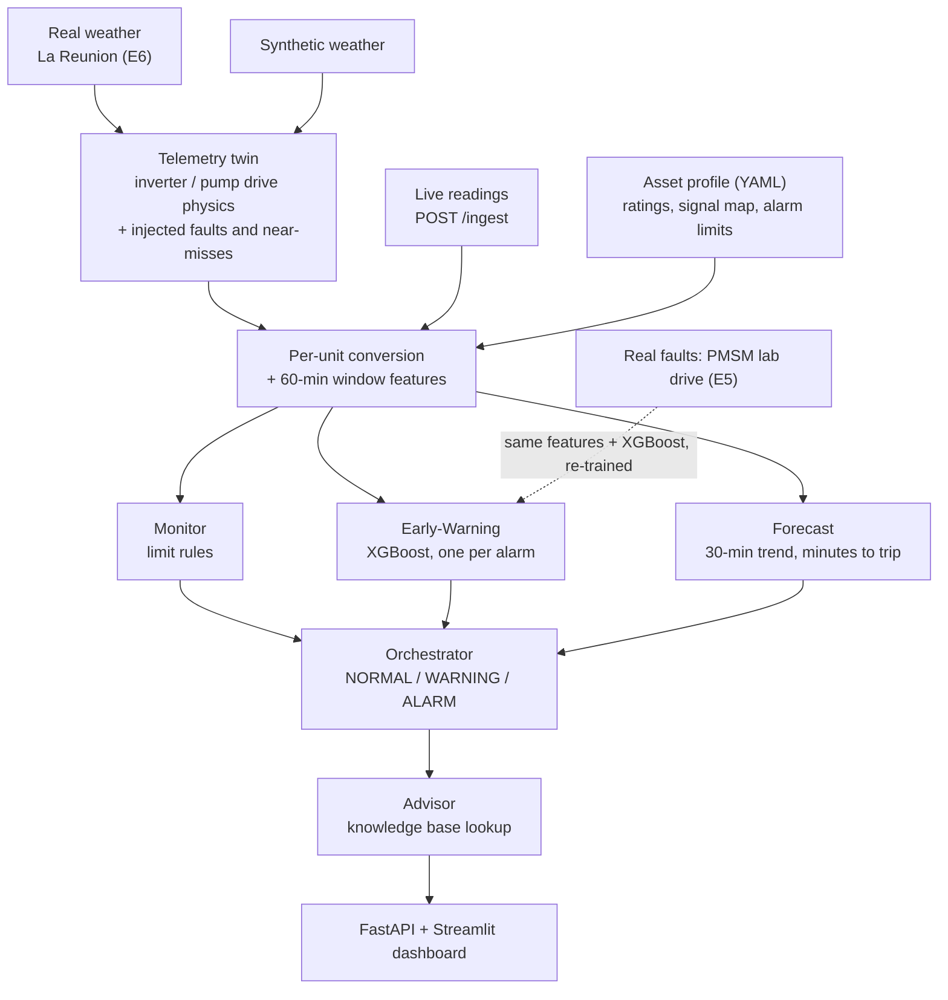

# Architecture

This document explains how the platform is built: the data flow, each component, the two ways it runs (offline
experiments and live service) and the main design decisions. For results see [`RESULTS.md`](RESULTS.md).

## 1. Overview

Only the Early-Warning Agent is a trained model. Monitor and Forecast are rules and arithmetic; Advisor is a lookup.
The ASPIRE-style Transformer in `src/pdm/baseline/` is used only in experiments, for comparison.

## 2. Components

| Component | File | What it does |
| --- | --- | --- |
| Asset profile | `configs/profiles/*.yaml`, `src/pdm/profiles.py` | Rating block, raw-signal-to-role map, alarm list (signal, direction, per-unit limit, condition, warning horizon) |
| Per-unit transform | `Profile.to_pu` | Divides each signal by its rating or trip limit, so 1.0 = at rating / at trip point |
| Telemetry twin | `src/pdm/twin/` | Weather (synthetic or measured) → healthy physics → fault episodes, 1-minute resolution |
| Labels | `src/pdm/labels.py` | Debounce 2 min; onset after 30 min clear; the horizon before each onset = Warning |
| Features | `src/pdm/features.py` | Per signal: last, mean, std, min, max, 60- and 15-min slope; per alarm: distance and time to limit |
| Monitor | `agents/monitor.py` | Alarm if the limit is crossed with the condition true for 2 minutes |
| Early-Warning | `agents/early_warning.py` | XGBoost (300 trees, depth 5, lr 0.05), class-weighted; threshold tuned on the last 20% of training |
| Forecast | `agents/forecast.py` | Least-squares line on the last 30 min → minutes to limit within 60 min |
| Advisor | `agents/advisor.py`, `knowledge/fault_kb.yaml` | Code → causes, checks, steps, safety, source; optional Ollama rewording of that entry only |
| Orchestrator | `agents/orchestrator.py` | Calls the agents and returns one record per step |
| API | `src/pdm/serve/api.py` | Buffer of 1,440 readings per device; `/ingest`, `/status`, `/forecast`, `/advice`, live feed |
| Dashboard | `app/dashboard.py` | Live telemetry, alarms and forecast, advisor checklist, profile view |

## 3. Two ways the platform runs

| | Offline (experiments and training) | Live (service) |
| --- | --- | --- |
| Entry point | `scripts/run_experiments.py`, `scripts/train.py` | `uvicorn pdm.serve.api:app` + `streamlit run app/dashboard.py` |
| Data | Twin runs (synthetic or measured weather) | Readings posted to `/ingest` or the built-in feed |
| Model | Trained, thresholds tuned, saved as `.pkl` | Loaded from `results/models/`, never retrained |
| Output | `results/<experiment>/` tables, figures, `report.md` | JSON status every step, dashboard |

## 4. Data and evaluation

| Experiment | Question | Data | Output folder |
| --- | --- | --- | --- |
| E1 | Can 19 alarms be predicted early on the trained rating? | Twin, synthetic weather | `results/synthetic_weather/` |
| E2 | Does the same model work on unseen ratings? | Twin, 3 and 10 kW / HP | `results/synthetic_weather/` |
| E3 | How accurate is minutes-to-trip? | Twin, thermal alarms | `results/synthetic_weather/` |
| E4 | Does the Advisor return the right entry? | Twin alarm events | `results/synthetic_weather/` |
| E5 | Do the features and model recognise **real** faults? | PMSM lab drive, 10 Hz | `results/real_faults/` |
| E6 | Do E1–E2 hold with **real** weather? | Twin + La Reunion weather | `results/real_weather/` |

Leakage controls: training uses seed 1 (and weather days 0–59); test seeds 11–13 use later, unseen days; thresholds
are tuned only on the last 20% of training; in E5, test windows never share samples with training windows.

## 5. Design decisions

- **Per-unit, limit-aware features instead of a bigger model.** Measuring each signal against its own limit makes the
  same number mean the same risk on every rating. This gave both the accuracy gain and the transfer across ratings.
- **XGBoost instead of a Transformer.** Trains in minutes on a CPU, needs less data, is easier to explain, and scored
  higher than the ASPIRE-style Transformer on the same windows.
- **Rules for the Monitor, trend for the Forecast.** A crossed limit needs no learning; the trend line was the only
  forecaster that caught approaching trips.
- **Advice by alarm code, not free-text search.** The Early-Warning Agent already names the alarm, so the right entry is
  retrieved directly; an optional LLM may only reword that entry.
- **Twin data with near-misses.** No public dataset labels these alarms; near-miss episodes keep false-alert rates honest.
