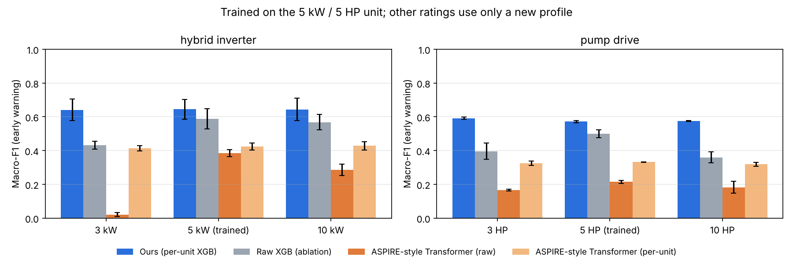
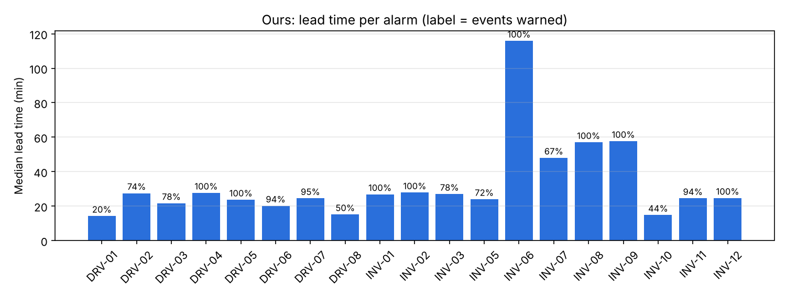
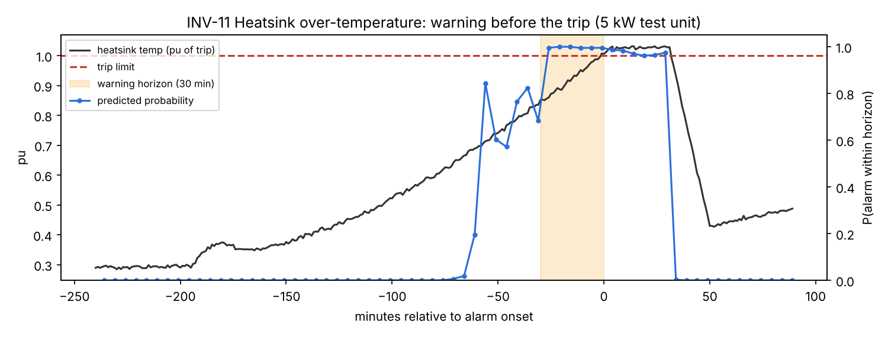
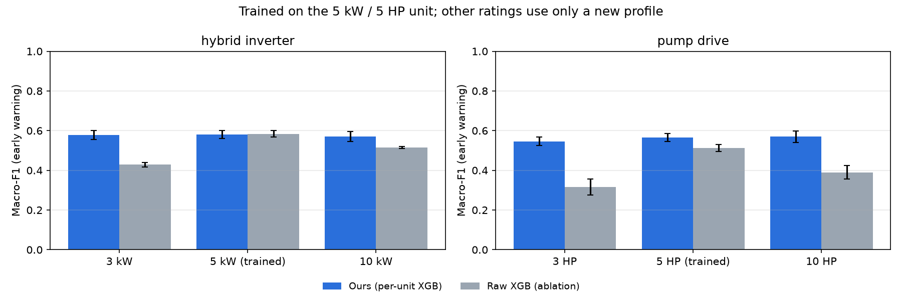

# Phase II results: rating-aware multi-agent fault prediction

## Project overview

**Goal.** Warn operators before an alarm trips on two solar assets: a hybrid inverter (PV + battery + grid + generator) and a solar water-pump drive. The system also forecasts the time to trip and gives a cited maintenance checklist. One model serves every power rating of an asset type (3, 5 and 10 kW / HP).

**Pipeline (one step every 5 minutes, 60 minutes of history):**

| Step | Agent | What it does |
| --- | --- | --- |
| 1 | Profile | Maps the device's raw signals to roles and divides by the device rating (per-unit), so ratings look alike |
| 2 | Monitor | Rule check: is an alarm limit crossed right now? |
| 3 | Early-Warning | XGBoost, one classifier per alarm: will this alarm trip within its warning horizon (30-120 min)? |
| 4 | Forecast | Trend forecast of the warned signal: minutes until it crosses the limit |
| 5 | Advisor | Alarm code to knowledge-base entry: causes, checks, steps, safety, source; optional LLM wording from live readings |

**Delivery.** A FastAPI service (`/ingest`, `/status`, `/forecast`, `/advice`, built-in live feed) and a Streamlit dashboard: asset switch, live telemetry with alarm limits, active and predicted alarms, forecast-to-trip chart and a maintenance checklist.

**Data used in this report.**

| Part | Data | Real or simulated |
| --- | --- | --- |
| E1-E4 | Telemetry twin with synthetic weather; faults injected as gradual ramps | Simulated |
| E5 | Inverter-driven PMSM lab fault dataset (Zenodo 10.5281/zenodo.14482932) | **Real** measurements and real faults |
| E6 | Telemetry twin driven by measured weather from a La Reunion rooftop PV plant (Zenodo 10.5281/zenodo.7157424) | **Real** weather; device telemetry and faults simulated |

## Results on the telemetry twin (E1-E4)

Test set: 40 days per unit, 3 random seed(s) per rating, unseen weather and fault timings. Training: one 60-day unit per asset type (5 kW inverter, 5 HP pump drive). Weather is synthetic in E1-E4; E6 repeats E1 and E2 with measured weather.

## E1 - Multi-fault early warning (trained rating, unseen seeds)

All methods see the same windows (60 min history, a prediction every 5 min) and tune one threshold per alarm on the last 20% of training. The ASPIRE-style Transformer is trained for 25 epochs on every training window with class-weighted loss. Means over seeds; std across seeds.

| asset | method | macro_f1 | macro_f1_std | macro_pr_auc | event_recall | median_lead_min | false_alerts_per_day |
| --- | --- | --- | --- | --- | --- | --- | --- |
| hybrid_inverter | Raw XGB (ablation) | 0.588 | 0.059 | 0.672 | 0.806 | 27.167 | 2.042 |
| hybrid_inverter | ASPIRE-style Transformer (per-unit) | 0.425 | 0.021 | 0.550 | 0.970 | 27.500 | 5.350 |
| hybrid_inverter | ASPIRE-style Transformer (raw) | 0.385 | 0.021 | 0.442 | 0.883 | 28.000 | 4.917 |
| hybrid_inverter | Ours (per-unit XGB) | 0.645 | 0.059 | 0.712 | 0.869 | 27.667 | 2.708 |
| pump_drive | Raw XGB (ablation) | 0.500 | 0.024 | 0.617 | 0.744 | 18.250 | 1.083 |
| pump_drive | ASPIRE-style Transformer (per-unit) | 0.332 | 0.002 | 0.458 | 0.814 | 27.333 | 5.158 |
| pump_drive | ASPIRE-style Transformer (raw) | 0.215 | 0.010 | 0.305 | 0.856 | 27.250 | 8.967 |
| pump_drive | Ours (per-unit XGB) | 0.572 | 0.006 | 0.652 | 0.765 | 23.917 | 0.783 |

## E2 - Unseen power ratings (profile swap only, no retraining)

Macro-F1. Smaller = 3 kW / 3 HP, larger = 10 kW / 10 HP. Drop = trained minus unseen (lower is better).

| asset | method | trained rating | smaller rating | larger rating | drop_smaller | drop_larger |
| --- | --- | --- | --- | --- | --- | --- |
| hybrid_inverter | Raw XGB (ablation) | 0.588 | 0.432 | 0.568 | 0.156 | 0.020 |
| hybrid_inverter | ASPIRE-style Transformer (per-unit) | 0.425 | 0.413 | 0.428 | 0.011 | -0.003 |
| hybrid_inverter | ASPIRE-style Transformer (raw) | 0.385 | 0.021 | 0.286 | 0.364 | 0.099 |
| hybrid_inverter | Ours (per-unit XGB) | 0.645 | 0.641 | 0.643 | 0.004 | 0.002 |
| pump_drive | Raw XGB (ablation) | 0.500 | 0.396 | 0.359 | 0.104 | 0.140 |
| pump_drive | ASPIRE-style Transformer (per-unit) | 0.332 | 0.325 | 0.319 | 0.007 | 0.012 |
| pump_drive | ASPIRE-style Transformer (raw) | 0.215 | 0.167 | 0.183 | 0.048 | 0.032 |
| pump_drive | Ours (per-unit XGB) | 0.572 | 0.591 | 0.575 | -0.020 | -0.003 |



## Per-alarm results for our method (trained rating, mean over seeds)

| asset | alarm | precision | recall | f1 | pr_auc | events | event_recall | median_lead_min | false_alerts_per_day |
| --- | --- | --- | --- | --- | --- | --- | --- | --- | --- |
| hybrid_inverter | INV-01 | 0.687 | 0.944 | 0.794 | 0.918 | 6.000 | 1.000 | 26.833 | 0.292 |
| hybrid_inverter | INV-02 | 0.549 | 0.954 | 0.695 | 0.805 | 6.000 | 1.000 | 27.833 | 0.425 |
| hybrid_inverter | INV-03 | 0.548 | 0.704 | 0.607 | 0.657 | 6.000 | 0.778 | 27.000 | 0.150 |
| hybrid_inverter | INV-05 | 0.828 | 0.500 | 0.597 | 0.792 | 6.000 | 0.722 | 24.000 | 0.050 |
| hybrid_inverter | INV-06 | 0.748 | 0.914 | 0.820 | 0.881 | 6.000 | 1.000 | 115.833 | 0.325 |
| hybrid_inverter | INV-07 | 0.389 | 0.361 | 0.369 | 0.413 | 6.000 | 0.667 | 48.000 | 0.433 |
| hybrid_inverter | INV-08 | 0.698 | 0.944 | 0.798 | 0.817 | 6.000 | 1.000 | 57.000 | 0.333 |
| hybrid_inverter | INV-09 | 0.788 | 0.958 | 0.863 | 0.938 | 6.000 | 1.000 | 57.667 | 0.158 |
| hybrid_inverter | INV-10 | 0.607 | 0.287 | 0.388 | 0.536 | 6.000 | 0.444 | 14.833 | 0.058 |
| hybrid_inverter | INV-11 | 0.662 | 0.778 | 0.713 | 0.788 | 6.000 | 0.944 | 24.500 | 0.142 |
| hybrid_inverter | INV-12 | 0.321 | 0.764 | 0.452 | 0.292 | 4.667 | 1.000 | 24.667 | 0.342 |
| pump_drive | DRV-01 | 0.433 | 0.067 | 0.115 | 0.198 | 5.333 | 0.200 | 14.250 | 0.025 |
| pump_drive | DRV-02 | 0.537 | 0.603 | 0.568 | 0.622 | 6.333 | 0.738 | 27.500 | 0.150 |
| pump_drive | DRV-03 | 0.649 | 0.533 | 0.584 | 0.634 | 4.333 | 0.783 | 21.667 | 0.092 |
| pump_drive | DRV-04 | 0.740 | 0.954 | 0.828 | 0.910 | 6.000 | 1.000 | 27.667 | 0.100 |
| pump_drive | DRV-05 | 0.509 | 0.717 | 0.594 | 0.611 | 3.333 | 1.000 | 23.667 | 0.200 |
| pump_drive | DRV-06 | 0.906 | 0.675 | 0.772 | 0.817 | 6.333 | 0.944 | 20.167 | 0.033 |
| pump_drive | DRV-07 | 0.763 | 0.754 | 0.755 | 0.827 | 7.333 | 0.952 | 24.500 | 0.133 |
| pump_drive | DRV-08 | 0.690 | 0.259 | 0.360 | 0.595 | 6.000 | 0.500 | 15.167 | 0.050 |





## E3 - Forecast Agent (60-minute horizon)

Mean absolute error in per-unit:

| asset | signal | persistence | seasonal | trend |
| --- | --- | --- | --- | --- |
| hybrid_inverter | battery_soc | 0.036 | 0.012 | 0.015 |
| hybrid_inverter | heatsink_temp | 0.025 | 0.024 | 0.024 |
| hybrid_inverter | output_power | 0.049 | 0.052 | 0.059 |
| pump_drive | heatsink_temp | 0.028 | 0.028 | 0.045 |
| pump_drive | output_power | 0.068 | 0.061 | 0.146 |
| pump_drive | tank_level | 0.046 | 0.023 | 0.041 |

Time to trip, forecast made 30 minutes before each thermal alarm (caught = forecast crosses the limit within 60 min):

| asset | alarm | method | events | caught_rate | abs_err_min |
| --- | --- | --- | --- | --- | --- |
| hybrid_inverter | INV-11 | persistence | 6 | 0.000 |  |
| hybrid_inverter | INV-11 | seasonal | 6 | 0.000 |  |
| hybrid_inverter | INV-11 | trend | 6 | 0.833 | 4.600 |
| pump_drive | DRV-04 | persistence | 6 | 0.000 |  |
| pump_drive | DRV-04 | seasonal | 6 | 0.000 |  |
| pump_drive | DRV-04 | trend | 6 | 0.833 | 12.400 |

## E4 - Advisor Agent: correct manual entry per alarm event

| asset | ours_hit1 | ours_hit3 | readme_rag_hit1 | readme_rag_hit3 | events |
| --- | --- | --- | --- | --- | --- |
| hybrid_inverter | 0.988 | 1.000 | 0.092 | 0.257 | 584 |
| pump_drive | 0.910 | 0.998 | 0.114 | 0.385 | 413 |

Ours routes the Early-Warning agent's top alarm codes to their knowledge-base entries. README-style RAG queries the knowledge base with the raw sensor values, as the reference project does. A high score here mainly shows that the routing works; it depends on the Early-Warning agent naming the right alarm.

## E5 - Real-fault check: inverter-driven PMSM dataset

**Data.** Lab drive (three-phase MOSFET inverter feeding a PMSM), 10 Hz, 8 signals (phase currents Ia and Ib, DC-bus voltage and current, driver voltage, three half-bridge temperatures), 9 classes: F0 normal, F1-F2 switch open-circuit, F3-F5 switch short-circuit, F6-F8 half-bridge overheating. 10,892 samples, CC-BY-4.0.

**Method.** The same features as the Early-Warning agent (rolling mean, std, min, max and slope per signal) with XGBoost, re-trained on the real signals, since the lab data does not label our alarm codes. Window 20 samples (2 s), one window every 5 samples.

**Split.** Each class is a single recording, so leave-one-recording-out is impossible. Each recording is cut into 4 time blocks; each fold tests one block and trains only on windows that share no samples with it (time-blocked 4-fold).

| Test | Signals | Classes | Window features + XGBoost (macro-F1) | Latest sample only (macro-F1) | Fault detection F1 (window) |
| --- | --- | --- | --- | --- | --- |
| All faults | all 8 | 9 | 0.921 | 0.939 | 0.988 |
| **Switch faults, electrical only** | Ia, Ib, VDC, IDC, VD | 6 (F0-F5) | **0.960** | **0.632** | 0.968 |

**Reading the results.** The temperature channels differ between recordings even without an overheating fault (for example T1 averages 510 counts in the normal recording and 496 in F1), so one sample is enough to tell the recordings apart. The first row is therefore optimistic for both methods. With temperatures removed, a single sample reaches only 0.632 macro-F1, while the window features reach 0.960. On real inverter signals, the window features are what make the switch faults separable. This checks fault classification on real data. It does not test early warning, because the lab faults start suddenly rather than growing slowly.

## E6 - Measured weather from a La Reunion rooftop PV plant

**Data.** Plane-of-array irradiance (GTI, W/m2) and ambient temperature (TA, degC) measured every second from Oct 2021 to Apr 2023, averaged to 1 minute. After filling gaps of up to 30 minutes and dropping incomplete days, 519 complete days remain. Training uses days 0-59; each test seed uses its own later block of days, so the test weather is never seen in training. Device telemetry and faults are still produced by the twin.

**Setup.** Same configuration as E1-E2: 60 training days, 40 test days, 3 seeds per rating. The Transformer baseline was not run here (no PyTorch in this environment); full tables are in `results/real_weather/report.md`.

E1 with measured weather (trained rating, mean over 3 seeds):

| asset | method | macro_f1 | macro_f1_std | macro_pr_auc | event_recall | median_lead_min | false_alerts_per_day |
| --- | --- | --- | --- | --- | --- | --- | --- |
| hybrid_inverter | Raw XGB (ablation) | 0.584 | 0.016 | 0.628 | 0.818 | 27.0 | 2.09 |
| hybrid_inverter | Ours (per-unit XGB) | 0.579 | 0.020 | 0.659 | 0.790 | 25.7 | 2.22 |
| pump_drive | Raw XGB (ablation) | 0.512 | 0.017 | 0.524 | 0.724 | 23.4 | 1.44 |
| pump_drive | Ours (per-unit XGB) | 0.566 | 0.020 | 0.561 | 0.772 | 25.5 | 1.77 |

E2 with measured weather (unseen ratings, macro-F1):

| asset | method | trained rating | smaller rating | larger rating | drop_smaller | drop_larger |
| --- | --- | --- | --- | --- | --- | --- |
| hybrid_inverter | Raw XGB (ablation) | 0.584 | 0.429 | 0.515 | 0.155 | 0.069 |
| hybrid_inverter | Ours (per-unit XGB) | 0.579 | 0.577 | 0.570 | 0.002 | 0.009 |
| pump_drive | Raw XGB (ablation) | 0.512 | 0.316 | 0.389 | 0.197 | 0.123 |
| pump_drive | Ours (per-unit XGB) | 0.566 | 0.546 | 0.570 | 0.019 | -0.004 |



**Reading the results.** On the rating it was trained on, the per-unit model ties the raw-feature model on the inverter (0.579 vs 0.584, within one standard deviation; PR-AUC 0.659 vs 0.628) and beats it on the pump drive (0.566 vs 0.512). The clear gain is on unseen ratings: the per-unit model loses at most 0.019 macro-F1 when moved to a 3 or 10 kW / HP unit without retraining, while the raw-feature model loses 0.07-0.20. Compared with synthetic weather (E1), scores with measured weather are similar for the pump drive and about 0.07 lower for the inverter, whose telemetry depends more on irradiance.

## Scope compared with the ASPIRE baseline

| Item | ASPIRE (as reproduced in Phase I) | This framework |
| --- | --- | --- |
| Assets | Metro air compressor (MetroPT-3) | Hybrid inverter, solar pump drive |
| Alarm types predicted | 1 failure category | 19 |
| Power ratings | 1 | 3 per asset type, by profile |
| Fix guidance | None | Cited checklist per alarm |
| Real data | MetroPT-3 | Real lab faults (PMSM drive, E5); real measured weather (E6) |

## Limitations

- Faults in E1-E4 and E6 are injected into twin telemetry; thresholds are placeholders until replaced with datasheet values.
- Per-unit features remove rating scale by design in the twin; real multi-rating field data is needed to confirm the cross-rating gain.
- E5 checks fault classification on real lab signals, not early warning: the lab faults start abruptly and each class is a single recording. Recording-specific offsets (seen in the temperature channels) can inflate scores, so the electrical-only result is the one to quote.
- E6 uses real weather but simulated device behaviour, and does not yet include the Transformer baseline.
- The knowledge base is authored from general practice; replace each source with the manual page of the reference device.
- ASPIRE-style baseline re-implements the Prediction Agent's Transformer only, not the full ASPIRE system.

## Reproducing the results

Run from the repository root with the project virtual environment:

```bash
python scripts/run_experiments.py                                   # E1-E4, synthetic weather -> results/synthetic_weather/
python scripts/prepare_pmsm.py                                      # E5 data: downloads the 1 MB zip
python scripts/validate_real.py --csv data/real/pmsm_10hz.csv --split blocks --window 20 --out results/real_faults --tag window
python scripts/validate_real.py --csv data/real/pmsm_10hz.csv --split blocks --window 20 --features instant --out results/real_faults --tag instant
python scripts/validate_real.py --csv data/real/pmsm_10hz.csv --split blocks --window 20 --signals Ia Ib VDC IDC VD --labels F0 F1 F2 F3 F4 F5 --out results/real_faults --tag electrical_window
python scripts/validate_real.py --csv data/real/pmsm_10hz.csv --split blocks --window 20 --signals Ia Ib VDC IDC VD --labels F0 F1 F2 F3 F4 F5 --features instant --out results/real_faults --tag electrical_instant
python scripts/prepare_reunion_weather.py                           # E6 data: streams the 2.2 GB file (about 6 min)
python scripts/run_experiments.py --weather data/real/reunion_weather_1min.csv --out results/real_weather   # E6
```

The Transformer baseline needs PyTorch (`pip install torch`), for example in the Colab notebook.