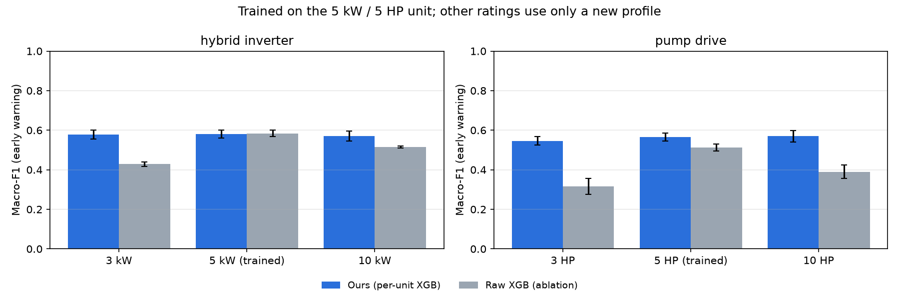
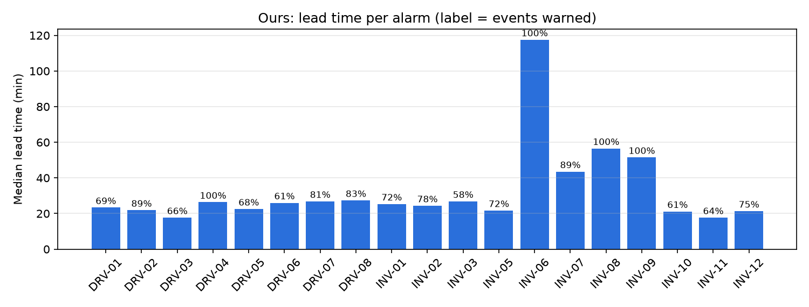
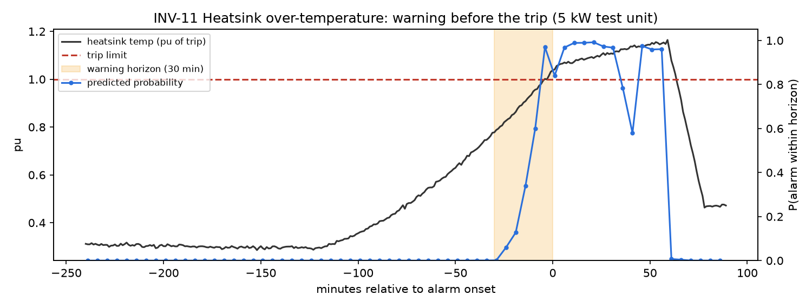

# Phase II results: rating-aware multi-agent fault prediction

Test set: 40 days per unit, 3 random seed(s) per rating, unseen weather and fault timings. Training: one 60-day unit per asset type (5 kW inverter, 5 HP pump drive). Weather is measured irradiance and ambient temperature (data/real/reunion_weather_1min.csv); training and each test seed use different, non-overlapping days. Device telemetry and faults come from the telemetry twin (see Limitations).

## E1 - Multi-fault early warning (trained rating, unseen seeds)

All methods see the same windows (60 min history, a prediction every 5 min) and tune one threshold per alarm on the last 20% of training. The ASPIRE-style Transformer is trained for 25 epochs on every 1-th window with class-weighted loss. Means over seeds; std across seeds.

| asset | method | macro_f1 | macro_f1_std | macro_pr_auc | event_recall | median_lead_min | false_alerts_per_day |
| --- | --- | --- | --- | --- | --- | --- | --- |
| hybrid_inverter | Raw XGB (ablation) | 0.584 | 0.016 | 0.628 | 0.818 | 27.000 | 2.092 |
| hybrid_inverter | Ours (per-unit XGB) | 0.579 | 0.020 | 0.659 | 0.790 | 25.667 | 2.217 |
| pump_drive | Raw XGB (ablation) | 0.512 | 0.017 | 0.524 | 0.724 | 23.417 | 1.442 |
| pump_drive | Ours (per-unit XGB) | 0.566 | 0.020 | 0.561 | 0.772 | 25.500 | 1.767 |

## E2 - Unseen power ratings (profile swap only, no retraining)

Macro-F1. Smaller = 3 kW / 3 HP, larger = 10 kW / 10 HP. Drop = trained minus unseen (lower is better).

| asset | method | trained rating | smaller rating | larger rating | drop_smaller | drop_larger |
| --- | --- | --- | --- | --- | --- | --- |
| hybrid_inverter | Raw XGB (ablation) | 0.584 | 0.429 | 0.515 | 0.155 | 0.069 |
| hybrid_inverter | Ours (per-unit XGB) | 0.579 | 0.577 | 0.570 | 0.002 | 0.009 |
| pump_drive | Raw XGB (ablation) | 0.512 | 0.316 | 0.389 | 0.197 | 0.123 |
| pump_drive | Ours (per-unit XGB) | 0.566 | 0.546 | 0.570 | 0.019 | -0.004 |

## Per-alarm results for our method (trained rating, mean over seeds)

| asset | alarm | precision | recall | f1 | pr_auc | events | event_recall | median_lead_min | false_alerts_per_day |
| --- | --- | --- | --- | --- | --- | --- | --- | --- | --- |
| hybrid_inverter | INV-01 | 0.700 | 0.472 | 0.545 | 0.718 | 6.000 | 0.722 | 25.333 | 0.108 |
| hybrid_inverter | INV-02 | 0.658 | 0.648 | 0.641 | 0.694 | 6.000 | 0.778 | 24.333 | 0.208 |
| hybrid_inverter | INV-03 | 0.345 | 0.511 | 0.412 | 0.524 | 5.667 | 0.578 | 26.833 | 0.267 |
| hybrid_inverter | INV-05 | 0.587 | 0.565 | 0.559 | 0.616 | 6.000 | 0.722 | 21.667 | 0.150 |
| hybrid_inverter | INV-06 | 0.608 | 0.968 | 0.746 | 0.805 | 6.000 | 1.000 | 117.500 | 0.408 |
| hybrid_inverter | INV-07 | 0.849 | 0.542 | 0.661 | 0.767 | 6.000 | 0.889 | 43.500 | 0.183 |
| hybrid_inverter | INV-08 | 0.708 | 0.921 | 0.798 | 0.757 | 6.000 | 1.000 | 56.500 | 0.183 |
| hybrid_inverter | INV-09 | 0.669 | 0.810 | 0.726 | 0.750 | 6.000 | 1.000 | 51.500 | 0.192 |
| hybrid_inverter | INV-10 | 0.675 | 0.389 | 0.476 | 0.626 | 6.000 | 0.611 | 21.167 | 0.067 |
| hybrid_inverter | INV-11 | 0.832 | 0.327 | 0.460 | 0.732 | 7.000 | 0.643 | 17.667 | 0.125 |
| hybrid_inverter | INV-12 | 0.254 | 0.556 | 0.348 | 0.257 | 4.333 | 0.750 | 21.333 | 0.325 |
| pump_drive | DRV-01 | 0.310 | 0.593 | 0.403 | 0.418 | 5.333 | 0.689 | 23.333 | 0.392 |
| pump_drive | DRV-02 | 0.814 | 0.572 | 0.670 | 0.669 | 6.667 | 0.889 | 21.833 | 0.158 |
| pump_drive | DRV-03 | 0.714 | 0.381 | 0.488 | 0.539 | 5.000 | 0.660 | 17.667 | 0.133 |
| pump_drive | DRV-04 | 0.651 | 0.950 | 0.772 | 0.860 | 5.667 | 1.000 | 26.333 | 0.183 |
| pump_drive | DRV-05 | 0.337 | 0.486 | 0.397 | 0.265 | 4.333 | 0.683 | 22.500 | 0.217 |
| pump_drive | DRV-06 | 0.859 | 0.583 | 0.681 | 0.625 | 6.000 | 0.611 | 26.000 | 0.025 |
| pump_drive | DRV-07 | 0.448 | 0.706 | 0.547 | 0.486 | 8.667 | 0.810 | 26.833 | 0.425 |
| pump_drive | DRV-08 | 0.521 | 0.630 | 0.565 | 0.626 | 6.000 | 0.833 | 27.333 | 0.233 |

## E3 - Forecast Agent (60-minute horizon)

Mean absolute error in per-unit:

| asset | signal | persistence | seasonal | trend |
| --- | --- | --- | --- | --- |
| hybrid_inverter | battery_soc | 0.031 | 0.018 | 0.015 |
| hybrid_inverter | heatsink_temp | 0.031 | 0.036 | 0.038 |
| hybrid_inverter | output_power | 0.050 | 0.053 | 0.060 |
| pump_drive | heatsink_temp | 0.028 | 0.033 | 0.040 |
| pump_drive | output_power | 0.068 | 0.079 | 0.118 |
| pump_drive | tank_level | 0.044 | 0.037 | 0.040 |

Time to trip, forecast made 30 minutes before each thermal alarm (caught = forecast crosses the limit within 60 min):

| asset | alarm | method | events | caught_rate | abs_err_min |
| --- | --- | --- | --- | --- | --- |
| hybrid_inverter | INV-11 | persistence | 7 | 0.000 |  |
| hybrid_inverter | INV-11 | seasonal | 7 | 0.143 | 8.000 |
| hybrid_inverter | INV-11 | trend | 7 | 1.000 | 10.000 |
| pump_drive | DRV-04 | persistence | 5 | 0.000 |  |
| pump_drive | DRV-04 | seasonal | 5 | 0.000 |  |
| pump_drive | DRV-04 | trend | 5 | 0.800 | 9.500 |

## E4 - Advisor Agent: correct manual entry per alarm event

| asset | ours_hit1 | ours_hit3 | readme_rag_hit1 | readme_rag_hit3 | events |
| --- | --- | --- | --- | --- | --- |
| hybrid_inverter | 0.985 | 1.000 | 0.087 | 0.247 | 583 |
| pump_drive | 0.885 | 0.974 | 0.113 | 0.385 | 416 |

Ours routes the Early-Warning agent's top alarm codes to their knowledge-base entries. README-style RAG queries the knowledge base with the raw sensor values, as the reference project does.

## Scope compared with the ASPIRE baseline

| Item | ASPIRE (as reproduced in Phase I) | This framework |
| --- | --- | --- |
| Assets | Metro air compressor (MetroPT-3) | Hybrid inverter, solar pump drive |
| Alarm types predicted | 1 failure category | 19 |
| Power ratings | 1 | 3 per asset type, by profile |
| Fix guidance | None | Cited checklist per alarm |

## Limitations

- Faults are injected into synthetic healthy telemetry; thresholds are placeholders until replaced with datasheet values.
- Per-unit features remove rating scale by design in this twin; real cross-rating data is needed to confirm the gain.
- Validate on real labelled faults (GPVS-Faults, inverter-driven PMSM dataset) with `scripts/validate_real.py` before claiming field performance.
- The knowledge base is authored from general practice; replace each source with the manual page of the reference device.
- ASPIRE-style baseline re-implements the Prediction Agent's Transformer only, not the full ASPIRE system.